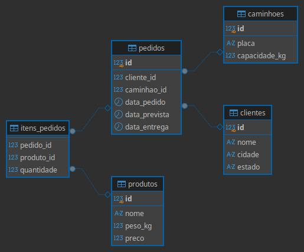

# Banco de Dados de uma Transportadora

Projeto de estudo em SQL: modelagem e análise do banco de dados de uma transportadora fictícia, a **RotaCerta Logística**, usando **PostgreSQL**.

## Objetivo

Organizar os dados de clientes, caminhões, produtos e pedidos e responder perguntas de negócio, como quais entregas atrasaram, qual caminhão está ocioso e se algum pedido passou da capacidade do veículo.

## Modelo de dados

- **clientes**: quem faz os pedidos
- **caminhoes**: a frota, com placa e capacidade em kg
- **produtos**: o que é transportado, com peso e preço
- **pedidos**: liga cliente e caminhão, com datas do pedido, prevista e de entrega
- **itens_pedidos**: os produtos e as quantidades de cada pedido (relação n:n)

## Como rodar

1. Crie um banco no PostgreSQL.
2. Rode `criar_tabelas.sql`.
3. Rode `inserir_dados.sql`.
4. Rode as consultas de `consultas.sql`.

## Perguntas respondidas

1. Quantos clientes há em cada estado?
2. Quantos pedidos cada cliente fez?
3. Qual cliente fez mais pedidos?
4. Quais pedidos atrasaram?
5. Quantos dias cada pedido atrasado atrasou?
6. Quais pedidos ainda não foram entregues?
7. Quantos pedidos cada caminhão levou?
8. Qual o valor total de cada pedido?
9. Qual o peso total de cada pedido? Algum passou da capacidade do caminhão?
10. Qual produto foi mais vendido?

## Principais descobertas

- **30% dos pedidos atrasaram** (3 de 10), com atraso médio de cerca de 3,7 dias.
- **O pedido 5 passou da capacidade do caminhão**: 1.262,5 kg num veículo de 1.000 kg.
- **Um caminhão está ocioso**: o MGB7C89 não fez nenhuma entrega.
- O produto mais vendido foi o **saco de cimento** (85 unidades).

## Tecnologias

PostgreSQL · SQL · DBeaver · VS Code

## Autor

Mateus Kauã Ferreira Corrêa · [LinkedIn](https://www.linkedin.com/in/mateuskferreira)
